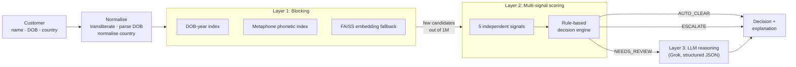

# Enfuce AML Sanctions Screener


-000000)


An **AI-powered entity-resolution engine** for anti-money-laundering (AML) sanctions screening, built for the **Dash × Enfuce hackathon**. Given a customer (name, date of birth, country), it decides whether that person could be on a sanctions list, and explains why.

It combines **hybrid retrieval** (FAISS vector search + phonetic + lexical blocking), **multilingual transformer embeddings**, an **explainable rule-based decision engine** and **LLM reasoning with structured outputs**, served as a real-time streaming API with a dashboard on top.

## Highlights

- **Semantic vector search at scale:** dense 384-dim multilingual sentence embeddings indexed in **FAISS**. It uses exact inner-product search for small lists and **HNSW approximate nearest neighbour (ANN)** search once a list passes 10K entries, with **GPU-accelerated FAISS** on the RunPod deployment.
- **Hybrid retrieval / candidate generation:** semantic (embedding), phonetic (Double Metaphone) and DOB inverted indexes are combined to keep recall high while cutting a **1M-entry** sanctions list down to a handful of candidates per customer.
- **Cross-lingual, cross-script name matching:** a multilingual transformer (`paraphrase-multilingual-MiniLM-L12-v2`) plus transliteration matches Cyrillic, Arabic and Latin spellings of the same person.
- **Multi-signal fuzzy matching:** Jaro-Winkler, phonetic, embedding cosine similarity, DOB and nationality are scored as five independent signals.
- **Explainable AI (XAI):** every decision has a per-signal breakdown and a human-readable rationale, shown in the UI's XAI detail panel. That kind of auditability matters in regulated compliance work.
- **LLM-in-the-loop reasoning:** only ambiguous cases are sent to an LLM (xAI Grok), prompted as a compliance officer and constrained to **structured JSON output** (decision, confidence, evidence). This is a retrieve-then-reason design that keeps LLM cost and latency low.
- **Cost-sensitive ML evaluation:** benchmarked on **216K labelled pairs** with confusion matrices. An experimental decision-tree classifier tuned for **F-β (β = 10)** to favour recall reached **F1 0.976** on a 43K holdout.
- **Real-time streaming inference:** single and batch screening streamed to the frontend over **Server-Sent Events**, with async concurrent LLM calls and cached embeddings and indexes for fast cold starts.

---

The hard part of sanctions screening isn't exact matches. It's names that are *nearly* the same: transliterations (`Aleksandr` / `Alexander` / `Александр`), reordered tokens, missing middle names, typos, and partial or missing birth dates. It also has to stay fast against a list of a million entries without flooding compliance teams with false positives.

Every customer gets one of three outcomes:

| Decision | Meaning |
|---|---|
| `AUTO_CLEAR` | No plausible match. No human needed. |
| `NEEDS_REVIEW` | Some signals agree, others don't. Sent to LLM reasoning or a human analyst. |
| `ESCALATE` | Strong multi-signal match. Treat as a likely hit. |

Each decision comes with a per-signal breakdown and a plain-language reason, so an analyst can see *why* the system decided what it did.

---

## How it works



### Layer 1: Blocking (cut 1M entries down to a handful)

Comparing every customer against every sanctioned person is too slow, so the backend first builds inverted indexes over the sanctions list and only scores plausible candidates ([`blocking_service.py`](backend/app/services/blocking_service.py)):

- **DOB year + phonetics:** the birth year matches *and* the names share at least two Double-Metaphone codes (one is enough when the full birth date is known).
- **Strong phonetics:** at least two shared phonetic codes regardless of DOB, so a wrong or missing birth year doesn't hide a match.
- **Missing DOB:** any shared phonetic code.
- **Embedding fallback:** a FAISS search over multilingual sentence embeddings (`paraphrase-multilingual-MiniLM-L12-v2`, 384-dim) adds candidates above cosine 0.55. This catches cross-script matches that phonetic codes miss.

Non-Latin names are transliterated with `unidecode` before phonetic coding. For large lists the bulk pipeline switches to an HNSW FAISS index, and on a GPU machine it uses `faiss-gpu`.

### Layer 2: Five independent signals plus a rule engine

Each candidate is scored on five signals, each normalised to 0–1 ([`screening_service.py`](backend/app/services/screening_service.py)):

| Signal | What it captures |
|---|---|
| **Name (Jaro-Winkler)** | Token-level, greedy 1-to-1 matching, so word order doesn't matter. Also tries transliterated forms. |
| **Phonetic** | Overlap of Metaphone codes: names that *sound* alike. |
| **Embedding** | Semantic and cross-script similarity from the multilingual model. |
| **DOB** | 1.0 for an exact date, 0.8 for the same year, 0.4 for ±1 year. Missing is tracked separately. |
| **Country** | Normalised nationality match. Missing is tracked separately. |

The signals are deliberately **not** blended into one weighted score. An ordered set of explicit rules turns them into a decision. For example:

- exact DOB + name JW ≥ 0.90 + no country conflict → `ESCALATE`
- exact DOB + embedding ≥ 0.75 → `NEEDS_REVIEW` (possible cross-script match)
- same birth year + strong name + country missing → `NEEDS_REVIEW`
- near-exact name + embedding, no DOB at all → `NEEDS_REVIEW`

Every rule produces a readable reason string. The design principle is that **missing data makes the system more cautious, never more lenient**: a customer with no DOB isn't auto-cleared just because there's nothing to contradict the match.

### Layer 3: LLM reasoning for the grey zone

Only `NEEDS_REVIEW` cases go to an LLM (xAI Grok via async `httpx`, [`llm_service.py`](backend/app/services/llm_service.py)). It's prompted as a compliance officer and must answer in strict JSON: a decision, a confidence score, and structured evidence (`name_match`, `dob_match`, `country_match`), plus a one- or two-sentence rationale. The prompt encodes domain rules such as "a shared common first name is never enough on its own." Layer 3 is optional; without an API key the system stops at Layer 2.

### Evaluation

The project includes labelled benchmark data and scripts to measure precision and recall:

- [`evaluate_pairs.py`](backend/evaluate_pairs.py) runs the Layer 2 engine over ~216K labelled (customer, sanction) pairs.
- [`evaluate_e2e.py`](backend/evaluate_e2e.py) runs the full pipeline end to end against an answer key.
- The **Evaluate** tab in the UI streams the layered pipeline over a whole customer file and shows a live confusion matrix.
- An experimental decision-tree matcher ([`backend/models/`](backend/models/)) trained on the pairs data reached **F1 0.976** on a 43K-pair holdout. It was tuned for F-β with β = 10, because in AML a missed sanctioned person costs far more than a false alert.

---

## The app

A Next.js dashboard with five tabs:

- **Screening:** screen one person and see every signal score and the reasoning, streamed live.
- **Batch:** upload a CSV of customers and watch results stream in over Server-Sent Events.
- **Sanctions:** browse and search the active sanctions list, switch between datasets (30 → 5K → 1M entries), or add an entry.
- **Evaluate:** run the layered pipeline over a labelled dataset and get a confusion matrix.
- **Pipeline:** an animated walkthrough of how the three layers work.

Access is password-gated. Without the password you log in as a **guest**, who is rate-limited and can only run single screenings. Batch, pipeline and dataset-switching routes are blocked for guests.

## Tech stack

| | |
|---|---|
| **Backend** | Python, FastAPI, pandas, FAISS, sentence-transformers, jellyfish (Jaro-Winkler / Metaphone), unidecode, httpx |
| **LLM** | xAI Grok (`grok-4-1-fast-reasoning`), structured JSON output |
| **Frontend** | Next.js 16, React 19, TypeScript, Tailwind CSS 4, shadcn/ui, GSAP |
| **Deploy** | RunPod GPU pod (`deploy.sh`), with FAISS on the GPU |

## Repository layout

```
backend/
  app/
    main.py              FastAPI app; loads model and builds indexes on startup
    auth.py              session auth (user / rate-limited guest)
    routers/             screening, batch (SSE), sanctions, pipeline, benchmark, stats
    services/
      blocking_service.py    Layer 1: DOB and phonetic inverted indexes
      embedding_service.py   FAISS index + multilingual embeddings
      screening_service.py   Layer 2: 5 signals + rule engine
      pipeline_service.py    bulk layered pipeline + confusion matrix
      llm_service.py         Layer 3: Grok compliance reasoning
  data/                  sanctions lists, customer sets, labelled pairs
  models/                experimental decision-tree matcher
  tests/                 pytest suite
  evaluate_*.py          offline evaluation scripts
frontend/
  app/, components/      Next.js dashboard (panels/ = one file per tab)
  lib/api.ts             typed API client
enfuce-architecture.md   full system architecture diagram
run-dev.sh               start backend + frontend locally
deploy.sh                one-shot RunPod deployment
```

## Running locally

Requirements: Python 3.11+ and Node 20+.

```bash
# installs dependencies into a venv, then starts both servers
./run-dev.sh --install-dependencies --environment .venv
```

- Backend: http://localhost:8000 (`/api/health` reports when the model and indexes are ready)
- Frontend: http://localhost:3000

The first start downloads the embedding model and builds the FAISS index. Later starts use a cache.

Optional: to enable Layer 3, create `backend/.env` with:

```
XAI_API_KEY=your-key
```

Run the tests:

```bash
cd backend && pytest
```

## API overview

| Method | Endpoint | Purpose |
|---|---|---|
| `POST` | `/api/screen` | Screen one customer |
| `POST` | `/api/screen-stream` | Same, with streamed progress |
| `POST` | `/api/batch-screen-stream` | Screen many customers (SSE) |
| `GET` | `/api/sanctions` | List or search sanctions |
| `POST` | `/api/sanctions/switch` · `/add` | Change dataset / add an entry |
| `POST` | `/api/pipeline/start`, `/layer/{1,2,3}` | Run the layered evaluation pipeline |
| `POST` | `/api/benchmark` | Benchmark on labelled pairs |
| `GET` | `/api/stats` · `/api/health` | Usage stats / readiness |
| `POST` | `/api/auth/login` | Get a session token |

---

*Built in a team at the Dash × Enfuce hackathon. This is a public copy of the original private repository.*
